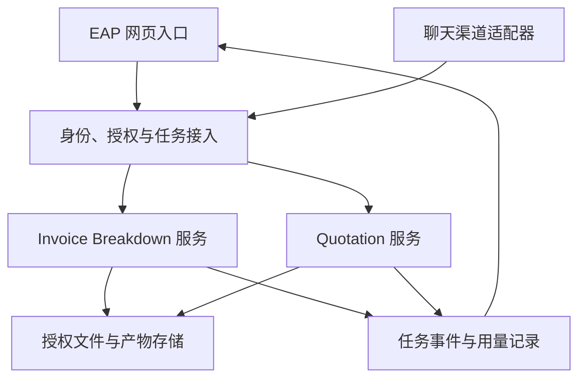

# EAP：当前能力与未来方向

更新日期：2026-11-22  
文档性质：项目定位与方向记录，不是已批准的实施任务列表。  
建议仓库位置：`docs/EAP-STATUS-AND-DIRECTION.md`

## 1. 项目定位

Enterprise AI Agent Platform（EAP）当前定位为 Agent 工程探索项目：探索通用执行循环、身份认证、权限、会话持久化、工具调用、人工介入及使用量追踪。

近期暂停扩展平台功能，将主要开发投入放到独立的 Invoice Breakdown 业务服务。Quotation 服务在业务规则明确后单独推进。EAP 保留为可运行的工程成果，未来可考虑整理为开源项目。

长期方向是统一 Agent 门户、专用工作流接入和任务管理。可以借鉴 LibreChat 类产品的入口体验，但不以复制其全部功能或开发完整可视化 Agent builder 为目标。

当前仅考虑单家公司内部使用，不引入多租户 SaaS 架构。未来开源并不意味着现在必须支持多租户、计费或插件市场。

## 2. 状态依据与验证边界

当前能力基于 2026-11-22 提供的《EAP Agent capability audit》及项目讨论整理。本文件没有重新检出仓库、运行测试或核实线上环境，也没有绑定具体 commit；不能替代发布验收。后续维护时应补充审计对应的 commit SHA 和复验日期。

原审计报告记录：181 项后端测试、30 项前端测试、5 个确定性评估案例通过；3 项后端检查跳过，socket 层断连测试未执行。该结果是历史报告，不能理解为当前分支的持续保证。

真实 Auth0 登录、PostgreSQL 重启后的恢复和隔离、真实模型输出、外部 MCP 服务以及 LangSmith 实际投递均未被该轮审计验证。以下“已接通”指代码路径及本地／模拟依赖测试证据，不代表生产环境验收完成。

## 3. 当前技术基础

- 后端：Python、FastAPI、LangGraph。
- 前端：React、TypeScript。
- 数据：PostgreSQL；项目采用 Supabase PostgreSQL，数据库迁移使用 Alembic。
- 会话恢复：LangGraph AsyncPostgresSaver。
- 通信：HTTP API 与 SSE。
- 身份：Auth0；当前角色／权限由 Auth0 放入 API Access Token，后端执行授权检查。
- 工程支持：自动化测试、确定性评估、可选 LangSmith 追踪；Docker 与 GHCR 为既定容器化方向，不据此声称线上部署已验收。

## 4. 当前能力清单

| 能力 | 当前状态 | 限制与待验证事项 |
| --- | --- | --- |
| 登录与 API 授权 | 已有 Auth0 集成、Token 验证和权限检查 | 本轮审计未测试真实 Auth0；Entra 企业连接尚未确认为已配置 |
| 用户目录、Group、Agent 访问管理 | 已有管理与授权基础 | 需复核 owning-group 编辑边界；不能把原型约定当作代码已满足 |
| 多轮文本聊天、历史、SSE | 代码路径已接通 | 需真实数据库重启恢复与隔离验证；删除会话实际为归档 |
| Stop、失败与恢复 | 部分实现 | 发送失败可能丢失草稿；中断后直接重发可能重复已执行工作 |
| 上下文预算、摘要、长期记忆 | 未实现 | 当前累积会话消息进入模型；浏览器 Agent 偏好不等于长期记忆 |
| 多步工具调用 | 已接通基础循环 | 主要工具为 add、multiply、echo 和文本技能加载器，不能当作完整业务工具集 |
| 人工确认与恢复 | 已有工具调用前暂停、会话所有者决定、恢复同次执行的路径 | 管理界面尚未暴露完整审批配置；不等于经理审批等业务审批制度 |
| 模型与指令配置 | 保存的模型、温度、系统指令和工具配置可影响执行 | 缺少完整模型能力校验；实际权限与原型差异需复核 |
| Instruction Skills | 指令文本可参与执行；有受控技能文本加载能力 | 不包含任意可执行技能包 |
| MCP 运行时 | 已有启动时发现、工具调用和服务端授权；通过进程内服务测试 | 外部服务未验证；缺少连接凭据／OAuth、自动重新发现等能力；不可用的已分配工具可能阻塞运行 |
| MCP 配置界面 | 浏览器本地模拟配置 | 显示 Connected 不代表后台连接成功；发布不能注册真实服务器 |
| 知识参考资料 | 保存文件名、大小等元数据 | 没有实际文件存储、解析、索引、检索或引用；元数据未进入执行上下文 |
| 聊天附件、多模态 | 原型／模拟展示 | 生产输入仍为文本；未打通文件解析、图片、音频或视频输入 |
| 工作簿、文档、图表和图片生成 | 原型／模拟展示 | 无完整的生成、持久化、预览和授权下载链路 |
| Usage 与运行详情 | 已有分页、模型调用 Token、工具状态／耗时、分币种估算费用 | 审计时价格表为空；历史未采集、未知和部分统计已有区分；请求预览与 My Usage 暂缓 |
| 追踪与评估 | 可选 LangSmith、离线图行为及工具权限评估 | 真实追踪投递和模型质量未验证；Agent 标签可能使用进程配置；缺少业务任务评估 |
| 联网搜索、网页读取、通用代码沙箱 | 未实现 | 不因模型或依赖支持而视为平台已具备 |

### 4.1 代码定位线索

以下为原审计提供的仓库相对路径，供后续复核；文件可能随代码演进移动。若放在 `docs/`，可从仓库根目录定位。

| 领域 | 路径 |
| --- | --- |
| 聊天与会话 | `frontend/src/components/chat/use-chat-workspace.ts`、`backend/app/api/routes/sessions.py` |
| 图、工具与恢复 | `backend/app/agents/graph.py`、`backend/app/agents/checkpointer.py`、`backend/app/agents/tool_policy.py` |
| MCP | `backend/app/agents/tools/mcp.py`、`backend/tests/test_mcp_integration.py` |
| 管理配置 | `frontend/src/components/manage/configuration-form.tsx`、`backend/app/services/agents.py` |
| 访问控制 | `backend/app/services/agent_access.py` |
| Usage | `frontend/src/components/manage/user-detail-page.tsx`、`backend/tests/test_execution_usage.py` |
| 追踪与评估 | `backend/app/agents/tracing.py`、`backend/evals/datasets/agent_core.json` |
| 产品原型 | `frontend/prototypes/agent-management` |

### 4.2 必须保留的产品边界

现有产品约定为两个固定 Agent，不因本方向文档自动增加创建／删除 Agent 的 UI。未来扩展注册与接入能力需要单独设计。

Group Leader 是每个 Group 的 designation，不是全局角色。成员管理只允许持有相应管理权限的管理员执行。Agent 的 owning group 与被授予使用权的 group 应区分：使用权不能自动变成编辑权。

原审计描述的“能看到 Agent 的 Group Leader 可以编辑 Instruction Skills／知识元数据”，可能比已确定的 owning-group 规则更宽。这是待核实差异，不应被批准为新的权限规则。

原型与生产配置保存方式也可能存在差异。本文件不替代现有原型，不授权修改角色、配置页面交互或扩大 Agent 目录。

## 5. EAP 与专用业务服务的边界

| 责任 | EAP（未来门户方向） | 独立业务 Agent 服务 |
| --- | --- | --- |
| 入口 | Agent 选择、统一任务界面、结果入口 | 提供任务 API 或简单测试界面 |
| 身份与权限 | 验证用户、判断可访问的 Agent、传递可信身份上下文 | 验证调用来源，并执行文件和业务操作授权 |
| 工作流 | 调用服务、展示状态、转交补充信息 | 在代码中定义专用 Graph、分支及恢复规则 |
| 业务规则 | 不复制各服务的业务计算规则 | 维护版本化规则、确定性计算与业务 QA |
| 文件与产物 | 展示授权文件引用和下载入口 | 按约定读取文件、生成产物并保证授权边界 |
| 可观测性 | 聚合任务摘要、耗时和费用 | 提供真实执行事件、检查记录和用量 |

Invoice Breakdown 与 Quotation 可以分别维护 Graph；通用聊天仍可使用 EAP 的模型—工具循环。Graph 代码、计算代码与测试存放在 Git 中，数据库保存配置、执行状态和产物元数据，不存储供运行时任意执行的 Python 代码。

两类服务不必共享全部实现。先复用必要且稳定的代码，等出现真实重复需求后再提取公共组件，避免先建设通用框架。

### 5.1 Invoice Breakdown 的独立目标

Invoice Breakdown 服务按批准的业务规格处理创建、修订、验证、解释、比较及相关函件草稿。其核心是来源控制总额核对、分类、区域分配、受保护金额、合同目标调整、舍入以及工作簿 QA。

它不是税务开票、供应商发票处理、付款核对或报价服务。不得将通用报价示例中的审批、CRM 写入等步骤自动加入该流程。按现有职责仅创建工作簿和起草函件，不发送、提交、签署、批准或更新外部业务系统。

具体业务规范与公司材料应保存在适当的私有项目中。本 EAP 文档只记录边界，不复制专有规则或真实项目数据。

## 6. 未来可选发展方向

以下均为候选方向，不是已实现能力或承诺交付日期。

| 方向 | 用户价值 | 开始实施的条件 | 最小验收结果 |
| --- | --- | --- | --- |
| 统一 Agent 门户 | 员工在一个入口找到获准使用的 Agent | 至少一个独立服务已能完成真实任务 | 授权用户能启动任务并取得结果；未授权用户无法访问 |
| 专用工作流接入 | 支持各自维护的业务 Graph | 第一个服务的输入、状态与输出已稳定 | 通过一个适配器启动、查询、补充信息并获取产物 |
| 任务管理 | 看清长任务进度与待处理事项 | 出现真实暂停／长运行任务 | 刷新后仍能看到状态；明确区分失败、等待和完成 |
| 企业文件访问 | 使用已有云端资料而非重复上传 | 身份映射和存储权限方案已验证 | 用户只能列出、读取和下载授权范围中的文件 |
| 产物中心 | 找回、预览和下载历史成果 | 服务能返回真实持久化产物 | 产物关联任务及版本，过期和权限变化有明确行为 |
| 质量与成本管理 | 判断哪种模型或流程值得使用 | 有业务基准样例和可靠用量记录 | 比较版本的正确性、失败率、耗时及分币种成本 |
| 渠道适配 | 从已有工作聊天工具使用 Agent | 已确定公司实际使用的渠道 | 一个渠道完成身份验证、任务提交、澄清与结果返回 |
| 开源基础 | 让其他开发者能运行和扩展 EAP | 部署路径稳定、公司数据与逻辑已分离 | 新开发者按文档运行合成数据示例并接入示例服务 |

优先组合：统一门户、专用工作流接入、任务管理。模型列表、语音、图像生成、跨会话记忆等按实际需求评估，不按功能清单追求全面覆盖。

## 7. 候选接入架构

以下为未来设计草图，不代表现有实现。

业务服务应能独立开发和运行，不以 EAP 上线为前提。聊天渠道适配器可以先直接连接业务服务，之后再按需要接入统一门户。

候选任务协议应覆盖：

- 启动任务：任务类型、输入文件引用、参数、幂等标识及可信调用上下文。
- 查询任务：服务任务 ID、执行版本、状态、进度和结构化错误。
- 补充信息：待回答问题 ID、回复内容和状态／版本校验。
- 取消任务：区分取消请求已接收和任务实际已停止。
- 获取产物：产物 ID、类型、文件名、来源关联及授权下载方式。
- 接收事件：带事件 ID 和顺序信息，以处理重复和重连。

任务状态可先讨论 `queued`、`running`、`waiting_for_input`、`succeeded`、`failed`、`cancelled`。需要审批的服务再增加适用状态，不要求所有服务具备审批能力。会话 ID、任务 ID、执行尝试 ID 应区分，防止把多轮对话当作同一次执行或重复累计费用。

身份不能只依赖客户端传入的 user ID。渠道身份需验证并映射；服务需验证可信调用和资源权限。停止浏览器请求不等于停止后台任务；请求重试也不应重复执行已完成的业务操作。

## 8. 身份与文件接入方向

已讨论的方向是保留 Auth0：继续由其签发 EAP API Token 并提供现有角色／权限；通过 Entra 企业连接支持公司员工登录，原有受控登录方式可用于受邀外部人员。

这仍属于待配置／待验证方案，不表示 Entra 已接通。企业连接套餐可用性、旧账号关联、角色分配和历史数据归属需要实施时确认。不得仅凭邮箱相同自动合并账号。

公司文件来源为 Azure Files。员工现有环境中只能访问自己的文件，但这不证明应用服务接入后会自动继承同样权限。登录、文件访问授权、网络连通和存储认证应分别验证。共享目录访问范围也应明确配置，不能从目录名称推断。

Azure Files、MCP 和 RAG 不互相等价：读取指定文件可直接使用后端连接器；MCP 是可选工具接入方式；只有需要按内容检索大量资料时才考虑检索索引。任何检索索引、缓存和产物同样需要权限隔离。

## 9. 推进顺序与进入条件

### 阶段 A：冻结当前探索基线

- 记录实际基线 commit、启动方式、环境变量名称、已实现与模拟功能。
- 保留当前代码和待办，不继续增加平台功能。
- 记录已知缺陷：草稿恢复、重复执行风险、MCP 假连接状态、权限偏差、上下文预算与追踪标签。
- 若继续提供演示，先明确标记模拟功能；这些问题不因暂停开发而视为已解决。

完成标准：现有项目可按文档复现，功能边界清晰，不把模拟演示描述为真实能力。

### 阶段 B：独立验证 Invoice Breakdown

- 获取批准的业务参考版本、脱敏来源工作簿与合格输出样例。
- 先通过上传文件或简单测试入口验证专用 Graph。
- 由确定性代码负责金额与校验，模型承担理解和有证据的分类。
- 记录业务正确性、人工修改量、耗时和无法自动解决的案例。

完成标准：业务人员认可代表性案例的结果，关键金额及来源可追溯；实际未完成的重算或视觉检查不得标为通过。

### 阶段 C：验证第二个服务并接入真实渠道

Quotation 的范围与规则另行确认。根据真实使用需求接入授权云端文件和一个聊天渠道，不同时开发全部渠道。

完成标准：两个服务各自边界清楚；识别哪些身份、任务、产物和可观测性需求真正重复。

### 阶段 D：将共性能力回收到 EAP

为已验证服务设计最小接入协议和适配器，逐步形成统一门户与任务管理。避免先做面向任意平台的完整协议。

完成标准：新增第二个服务无需复制门户核心逻辑；业务 Graph 仍可独立发布和测试。

### 阶段 E：评估开源发布

先确定许可、依赖使用条件、配置示例、迁移和部署说明，再准备开源版本。只包含合成样例、通用框架和可公开的示例服务。

完成标准：其他开发者能在没有公司账号、公司资料和私有基础设施的情况下运行示例。

## 10. 当前非目标

- 立即复制 LibreChat、Dify 或 Coze 的全部功能。
- 多租户 SaaS、商业计费、插件市场或完整可视化工作流编辑器。
- 在数据库中保存并执行任意用户提供的 Python 代码。
- 为每项能力都强制引入 Skills、MCP 或 RAG。
- 把公司的专用业务规则硬编码进 EAP 通用核心。
- 因未来门户方向立即扩大现有两个固定 Agent 的产品范围。
- 将公司文件、租户标识、员工信息、凭据或专有业务材料放入公开示例。

## 11. 文档维护原则

完成一个可验证增量后再更新能力状态；将代码已接通、本地测试、真实集成验证和业务验收分别记录。路线图中的建议只有转为明确任务并确认范围后才进入实施。

业务原型继续约束现有产品行为。本文件记录后续定位调整，任何与原型不同的 UI、权限或目录设计都必须单独说明，而不能通过这份方向文档默默覆盖。
