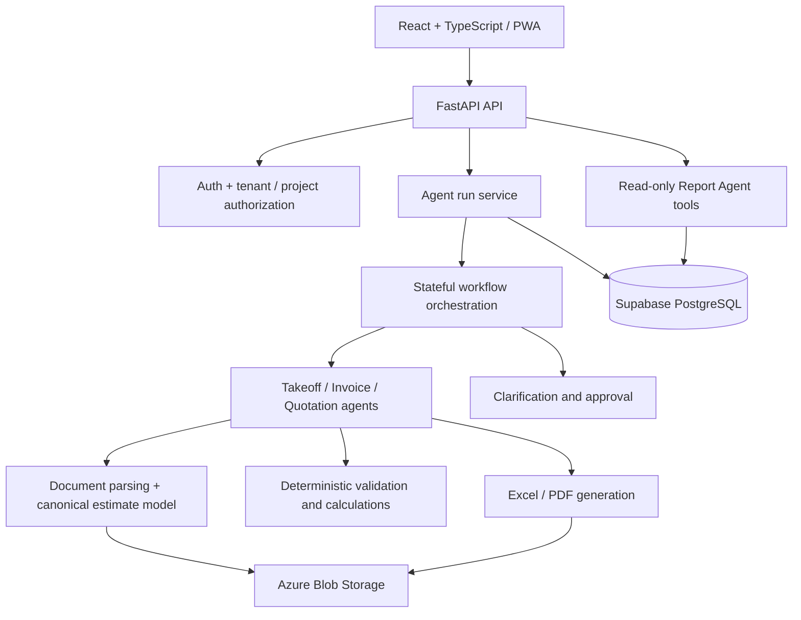

# Enterprise AI Agent Platform

> **Status: Planning / Initial development** · A portfolio project exploring reliable, human-supervised AI automation for document-heavy enterprise workflows.

An enterprise-oriented, multi-tenant AI agent platform for transforming structured and semi-structured business documents into validated outputs. The initial domain is **construction estimating and project administration**, using synthetic demonstration data.

The platform is designed to combine LLM-assisted interpretation with **deterministic calculations, explicit approval steps, access controls, and auditable execution**. It is not intended to let a language model independently decide financial totals or silently modify contractual scope.

## Problem

Construction and fit-out teams often process complex estimating spreadsheets manually to prepare quotations, cost breakdowns, and material takeoffs. The work is repetitive but high-stakes: spreadsheet hierarchies, optional items, markup, quantities, and rounding must be interpreted correctly. Managers also need reliable visibility into document-processing activity and verified business figures.

This project explores how an AI-assisted workflow can reduce repetitive work **without sacrificing traceability or human control**.

## Planned capabilities

| Module | Responsibility | Planned output |
| --- | --- | --- |
| **Takeoff Agent** | Extract and normalize material quantities by specification, unit, and project level; flag ambiguities | Reviewed Excel takeoff |
| **Invoice Breakdown Agent** | Classify monetary values into work categories and reconcile allocations against control totals | Validated Excel breakdown |
| **Quotation Agent** | Separate base scope from options, validate totals and GST, prepare customer-facing quotations | Reviewed quotation PDF |
| **Report Agent** | Answer authorized questions using validated business records and workflow status | Management summaries and dashboards |

The **Report Agent** will distinguish quotations, contract allocations, issued invoices, and actual revenue rather than treating them as interchangeable.

### Platform features (planned)

- Project and document management
- Stateful agent runs with progress, retry, and failure states
- Human-in-the-loop clarification, preview, and approval
- Tenant isolation and role-/project-based authorization
- Source provenance, audit trails, and reproducible outputs
- Usage tracking and limits for public demo safety
- Responsive React interface with optional PWA support

## Architecture (target)



**Design principle:** LLMs help interpret ambiguous content and choose permitted tools; Python code owns numerical calculations, reconciliation, authorization, and output validation.

## Technology stack (planned)

| Layer | Technologies |
| --- | --- |
| Frontend | React, TypeScript, Vite, Tailwind CSS, shadcn/ui |
| Backend | Python, FastAPI, Pydantic |
| Agent workflows | LangGraph, LLM tool calling |
| Data access | SQLAlchemy 2.x, Alembic |
| Database | Supabase PostgreSQL (session pooler; schema `agent_platform`) |
| File processing | openpyxl, pandas (where appropriate), ReportLab |
| File storage | Azure Blob Storage |
| Testing | pytest, Vitest |
| Quality | Ruff, mypy, ESLint, TypeScript |
| Infrastructure | Docker, Azure Container Apps, Azure Static Web Apps, Bicep; images on public GHCR |
| CI/CD | GitHub Actions |

Specific providers and libraries may evolve as implementation and evaluation progress.

## Core workflow (planned)

1. User uploads a spreadsheet to an authorized project.
2. Backend stores the original file and creates an `AgentRun`.
3. Parser preserves worksheet/cell provenance and builds a canonical estimate representation.
4. Workflow identifies ambiguous rows, hierarchy, options, and business classifications.
5. Deterministic rules validate quantities, amounts, markup, GST, and control totals.
6. User reviews flagged assumptions and a preview before approving.
7. Generator produces the final Excel or PDF, with a stored audit record.

A successful file preview **does not** automatically resolve unresolved business ambiguities.

## Security and reliability goals

- Enforce authorization at the API/tool/data layer, not in prompts alone.
- Treat uploaded spreadsheet text as untrusted data, not instructions.
- Prevent cross-tenant and cross-project access.
- Never expose LLM API keys or database credentials in the browser.
- Preserve original inputs and source references for auditing.
- Make long-running tasks resumable and avoid duplicate side effects.
- Apply file-size, request-rate, and AI-spend limits to the public demo.

## Evaluation plan

The initial test suite will use **synthetic** estimating spreadsheets and expected outputs, including cases for:

- Parent subtotals accidentally counted alongside child lines
- Markup or GST applied twice
- Base quotation items confused with optional scope
- Fixed categories incorrectly adjusted during reconciliation
- Quantities with zero rates, negative values, or mixed units
- Similar materials incorrectly merged despite different specifications
- Missing evidence, conflicting source totals, and required human approval
- Unauthorized cross-project or cross-tenant requests

Planned metrics include extraction accuracy, amount reconciliation, quantity correctness, clarification rate, task success, latency, and cost per run. **No evaluation results are claimed yet.**

## Development roadmap

- [ ] Bootstrap React, FastAPI, PostgreSQL, Docker, and quality checks
- [ ] Implement project/document/agent-run models and upload workflow
- [ ] Build canonical spreadsheet parser and source provenance
- [ ] Deliver first end-to-end **Takeoff Agent** with review and Excel export
- [ ] Add Invoice Breakdown Agent and reconciliation tests
- [ ] Add Quotation Agent and PDF validation
- [ ] Add read-only Report Agent and management dashboard
- [ ] Implement granular authorization, audit, and usage limits
- [ ] Deploy demo to Azure with GitHub Actions and Bicep
- [ ] Publish evaluation results, screenshots, and architecture decisions

## Local development

```text
frontend/       # React + TypeScript (Vite)
backend/        # FastAPI application and tests
infra/          # Azure Bicep modules and parameters
docs/           # Architecture, decisions, evaluation
.github/        # CI/CD workflows
```

### Frontend

```bash
cd frontend
cp .env.example .env
npm install
npm run dev
```

See [`frontend/README.md`](frontend/README.md). Set `VITE_API_BASE_URL` to the API origin. Backend / Docker Compose setup will be documented when that scaffold lands.

## CI/CD and deployment

**Single Azure environment:** public portfolio **demo** only (no separate Azure staging/production yet).

```text
Local Development → Pull Request CI → Merge to Main → Azure Demo
```

| Layer | Detail |
| --- | --- |
| Azure resource group | `rg-agent-platform-demo` |
| Bicep parameters | [`infra/parameters/demo.bicepparam`](infra/parameters/demo.bicepparam) |
| GitHub Environment | `demo` |
| Bicep `environment` / tags | `demo` (modules stay reusable for future `staging` / `production` param files) |

Infrastructure as Code: [`infra/`](infra/). Full ops guide: **[`infra/README.md`](infra/README.md)**.

| Workflow | Purpose |
| --- | --- |
| `.github/workflows/infra-ci.yml` | Bicep build/lint on `infra/**` (PR / push) |
| `.github/workflows/infra-cd.yml` | Manual infra deploy to Environment `demo` |
| `.github/workflows/backend-cd.yml` | GHCR build/push + Container App update (skips until `backend/Dockerfile`) |
| `.github/workflows/frontend-cd.yml` | SWA deploy (skips until `frontend/package.json`) |

- **Hosting (planned live):** Static Web Apps (`eastasia`), Container Apps + Blob (`australiasoutheast`); DB on Supabase; images on public GHCR.
- **Observability:** Application Insights + Log Analytics; Python apps still need OpenTelemetry instrumentation.

**Live demo:** Coming soon. Public demo will use synthetic data, rate limits, and LLM usage caps (see `infra/README.md`). Do not create Azure resources until an explicit deploy is approved.

## Documentation

Architecture diagrams, domain models, API contracts, ADRs, test fixtures, and evaluation reports will be added under `docs/` as development progresses.

## Data and licensing

This is an independent portfolio project. Public fixtures will be fictional or appropriately licensed; no confidential employer/client documents, proprietary templates, or credentials will be published.

**License:** To be decided. No license is granted by default until a license file is added.
