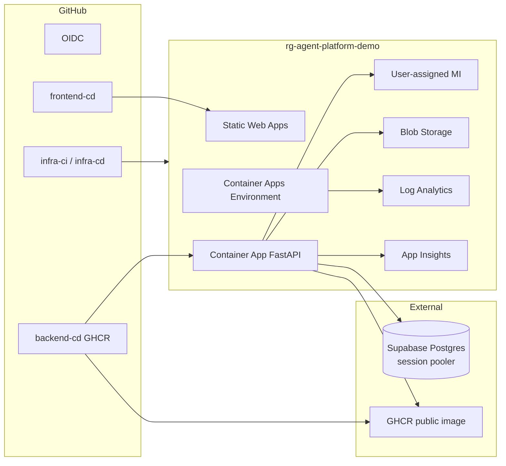

# Enterprise AI Agent Platform — Azure Infrastructure

Independent Azure infrastructure for the portfolio SaaS **demo**. Resource group: **`rg-agent-platform-demo`**.

| Concern | Value |
| --- | --- |
| Azure environment | **Single `demo`** |
| Resource group | `rg-agent-platform-demo` |
| Parameters | [`parameters/demo.bicepparam`](parameters/demo.bicepparam) |
| GitHub Environment | `demo` |
| Data plane / API region | `australiasoutheast` |
| Static Web Apps region | `eastasia` |
| Database | **External Supabase PostgreSQL** (not Azure) |
| Container images | **Public GHCR** (`ghcr.io/<user>/<image>:<tag>`) |
| Secrets (MVP) | Container Apps secrets + GitHub Environment secrets (no Key Vault) |

**Do not deploy to Azure until you explicitly approve a live deployment.**

---

## Architecture



### Resource inventory (provisioned)

| Resource | Notes |
| --- | --- |
| Log Analytics | PerGB2018 |
| Application Insights | Workspace-based |
| Storage Account | `uploads` / `outputs`; shared keys disabled; UAMI + RBAC |
| User-assigned managed identity | Blob Data Contributor (Phase 2) |
| Container Apps Environment | Consumption |
| Container App | Optional (`deployContainerApp`); public GHCR image; probes `/health` |
| Static Web Apps | Free; `eastasia` |

### Removed from IaC (do not auto-delete in Azure)

| Former resource | Replacement |
| --- | --- |
| Azure Database for PostgreSQL Flexible Server | Supabase PostgreSQL |
| Azure Container Registry | Public GHCR |

After Supabase + GHCR are verified, delete old Azure resources **manually** (commands below). Bicep does **not** use deployment stacks or cleanup automation.

---

## Phased deployment

1. **Bootstrap** — create `rg-agent-platform-demo`.
2. **Phase 1** — `deployContainerApp = false`: LAW, App Insights, Storage, UAMI, CAE, SWA.
3. **Manual once** — GitHub OIDC + RBAC; create Supabase project; push a **public** GHCR image.
4. **Phase 2** — set `deployContainerApp = true`, `containerImage = 'ghcr.io/<user>/agent-platform-api:<tag>'`, supply `DATABASE_URL` (and optionally `LLM_API_KEY` / `LANGSMITH_API_KEY`), redeploy.
5. **Ongoing** — `backend-cd` (GHCR push + image update) / `frontend-cd`. Prefer app CD over full infra CD.

---

## Secrets and environment variables

### Before local / CI deploy

| Variable / secret | When required | Purpose |
| --- | --- | --- |
| `AZURE_SUBSCRIPTION_ID` | Local `scripts/infra/deploy.sh` | Target subscription check |
| `AZURE_CLIENT_ID` / `AZURE_TENANT_ID` / `AZURE_SUBSCRIPTION_ID` | GitHub OIDC | Azure login |
| `DATABASE_URL` | When `deployContainerApp = true` | Supabase session-pooler URL → ACA secret `database-url` → env `DATABASE_URL` |
| `LLM_API_KEY` | Optional | When set, scripts pass `enableLlmApiKey=true` + `llmApiKey` → ACA secret `llm-api-key`. Demo expects a **DeepSeek** key (`llmProvider=deepseek` in `demo.bicepparam`) |
| `LANGSMITH_API_KEY` | Optional | When set, scripts pass `enableLangsmithTracing=true` + `langsmithApiKey` → ACA secret + `LANGSMITH_TRACING=true`. Project defaults to `agent-platform-demo`. Demo sets APAC `langsmithEndpoint` in params |
| `containerImage` (param) | When `deployContainerApp = true` | Public `ghcr.io/...` reference |
| `AZURE_STATIC_WEB_APPS_API_TOKEN` | frontend-cd | SWA deploy |
| `CONTAINER_APP_NAME` (GitHub var) | backend-cd | Image update target |
| `VITE_API_BASE_URL` (GitHub var) | frontend-cd | Public API URL |

**Never** commit `DATABASE_URL`. Prefer the Supabase **session pooler** host (IPv4-friendly), not the direct DB host if the runner/CAE lacks IPv6.

Example shape (do not commit real values):

```text
postgresql+psycopg://postgres.<project-ref>:<password>@aws-0-<region>.pooler.supabase.com:5432/postgres
```

Application schema: `POSTGRES_SCHEMA=agent_platform` (non-secret env on the Container App).

### Option A secret ownership

Bicep declares `database-url` always (Phase 2), and optional secrets only when their `enable*` flags are true (`llm-api-key`, `langsmith-api-key`). ARM cannot reliably `empty()` a `@secure()` value, so deploy scripts set those flags when the env vars are present. Non-secret LLM config (`LLM_PROVIDER`, optional `LLM_MODEL` / `LLM_BASE_URL`) always comes from Bicep params. Do not manage secrets via CLI/portal — a Bicep `secrets` array is replace-semantics. backend-cd updates **image only**.

### Validate before deploy

```bash
export DATABASE_URL='...'        # Phase 2 (required)
# export LLM_API_KEY='...'       # optional
# export LANGSMITH_API_KEY='...' # optional (demo traces → agent-platform-demo)
./infra/scripts/validate-deploy-secrets.sh infra/parameters/demo.bicepparam
```

Phase 1 (`deployContainerApp = false`) needs no application secrets.

---

## Local deploy

```bash
export AZURE_SUBSCRIPTION_ID='...'
# Phase 2:
export DATABASE_URL='...'
# export LLM_API_KEY='...'
# export LANGSMITH_API_KEY='...'
bash scripts/infra/deploy.sh
```

Or:

```bash
./infra/scripts/validate-deploy-secrets.sh infra/parameters/demo.bicepparam
az deployment group create \
  -g rg-agent-platform-demo \
  -f infra/main.bicep \
  -p infra/parameters/demo.bicepparam \
  -p databaseUrl="$DATABASE_URL"
# add llmApiKey=... enableLlmApiKey=true when you have an LLM key
# add langsmithApiKey=... enableLangsmithTracing=true when tracing
```

---

## GHCR (public images)

- Image format: `ghcr.io/<github-username>/agent-platform-api:<tag>`
- Container App has **no** `registries` credentials — package visibility must be **Public**.
- `backend-cd` builds/pushes with `packages: write` + `GITHUB_TOKEN`, then `az containerapp update --image`.

One-time: after the first push, set the package to Public in GitHub → Packages.

---

## Manual cleanup of obsolete Azure resources

Run **only after** Supabase connectivity and GHCR pulls are verified. Replace names with your deployment outputs / portal names.

```bash
RG=rg-agent-platform-demo

# List candidates
az postgres flexible-server list -g "$RG" -o table
az acr list -g "$RG" -o table

# Delete Flexible Server (irreversible — backups retained per Azure policy)
az postgres flexible-server delete \
  --resource-group "$RG" \
  --name <postgres-server-name> \
  --yes

# Delete ACR (irreversible — images gone)
az acr delete \
  --resource-group "$RG" \
  --name <acr-name> \
  --yes
```

Bicep no longer manages these resources; leaving them undeleted only incurs cost.

---

## GitHub Actions

| Workflow | Role |
| --- | --- |
| `infra-ci.yml` | Bicep build/lint; optional what-if |
| `infra-cd.yml` | Manual deploy; `DATABASE_URL` (+ optional `LLM_API_KEY`, `LANGSMITH_API_KEY`) |
| `backend-cd.yml` | GHCR build/push; Container App image update; `/health` |
| `frontend-cd.yml` | SWA deploy |

**Environment `demo` secrets:** `AZURE_CLIENT_ID`, `AZURE_TENANT_ID`, `AZURE_SUBSCRIPTION_ID`, `DATABASE_URL` (Phase 2), `LLM_API_KEY` (optional), `LANGSMITH_API_KEY` (optional), `AZURE_STATIC_WEB_APPS_API_TOKEN`

**Variables:** `CONTAINER_APP_NAME`, `VITE_API_BASE_URL`, optional `RUN_INFRA_WHAT_IF`

---

## Health probes

| Probe | Path |
| --- | --- |
| Startup / Liveness / Readiness | `/health` |

---

## Observability

App Insights is provisioned; FastAPI still needs `azure-monitor-opentelemetry` (or equivalent) using `APPLICATIONINSIGHTS_CONNECTION_STRING`.

---

## Local Bicep validation

```bash
az bicep build --file infra/bootstrap/main.bicep
az bicep build --file infra/main.bicep
az bicep lint --file infra/bootstrap/main.bicep
az bicep lint --file infra/main.bicep
```

---

## Layout

```text
infra/
  bootstrap/main.bicep
  main.bicep
  modules/
    app-insights.bicep
    container-app.bicep
    container-app-env.bicep
    identity-rbac.bicep      # Blob only (no AcrPull)
    log-analytics.bicep
    managed-identity.bicep
    static-web-app.bicep
    storage.bicep
  parameters/demo.bicepparam
  scripts/validate-deploy-secrets.sh
  README.md
```

**Deleted modules (obsolete):** `postgresql.bicep`, `container-registry.bicep`  
**Deleted scripts (obsolete):** `create-postgres-app-user.sh`, `create-postgres-app-user.sql`
