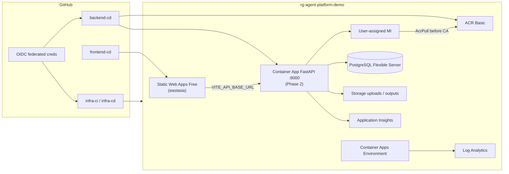

# Enterprise AI Agent Platform — Azure Infrastructure

Independent Azure infrastructure for the portfolio SaaS **demo**. All application resources live in resource group **`rg-agent-platform-demo`**.

| Concern | Value |
| --- | --- |
| Azure environment | **Single `demo`** (no separate Azure staging/production yet) |
| Resource group | `rg-agent-platform-demo` |
| Parameters file | [`parameters/demo.bicepparam`](parameters/demo.bicepparam) |
| GitHub Environment | `demo` |
| Data plane / API region | `australiasoutheast` |
| Static Web Apps region | `eastasia` (SWA is **not** available in Australia Southeast) |
| IaC | Bicep |
| Secrets store (MVP) | Container Apps secrets + GitHub Environment secrets (no Key Vault) |

**Deployment flow:** Local Development → Pull Request CI → Merge to Main → Azure Demo.

Bicep modules stay environment-agnostic via `param environment`; add `staging.bicepparam` / `production.bicepparam` later without rewriting modules.

**Greenfield dependency order (empty RG):** Log Analytics completes first; Application Insights and the Container Apps Environment both consume LAW outputs (`id` / `customerId` + secure `primarySharedKey`). UAMI is created and **AcrPull** is assigned **before** the Container App.

**Do not deploy to Azure until you explicitly approve a live deployment.**

---

## Architecture



### Resource inventory

| Resource | SKU / notes |
| --- | --- |
| Resource group | `rg-agent-platform-demo` (bootstrap) |
| Log Analytics | PerGB2018, 30-day retention |
| Application Insights | Workspace-based; Python OTel required for app traces |
| Azure Container Registry | Basic; admin user **disabled** |
| Storage Account | Standard_LRS; private containers `uploads`, `outputs`; HTTPS + TLS 1.2; shared keys **disabled** |
| PostgreSQL Flexible Server | Burstable `Standard_B1ms`; DB `agent_platform_db`; admin for migrations; runtime uses `eap_app` |
| User-assigned managed identity | Created in Phase 1; AcrPull before CA; Blob Data Contributor in Phase 2 |
| Container Apps Environment | Consumption; Log Analytics logs; **no custom VNet** (MVP) |
| Container App | Optional (`deployContainerApp`); port 8000; `/health/live` + `/health/ready`; UAMI |
| Static Web Apps | Free; created in **`eastasia`** |

**Not provisioned (documented only):** Key Vault, Azure OpenAI, Storage Queues, worker Container Apps / Jobs, private endpoints / NAT Gateway.

---

## Phased deployment

1. **Bootstrap** — subscription deployment creates `rg-agent-platform-demo`.
2. **Phase 1** — `deployContainerApp = false`: LAW, App Insights, ACR, Storage, PostgreSQL, **UAMI + AcrPull**, CAE, SWA. No Container App.
3. **Manual once** — GitHub OIDC app + federated credential + Azure RBAC (see below). Bicep does **not** assign the OIDC principal.
4. **Phase 1.5** — Create least-privilege DB role with [`scripts/create-postgres-app-user.sh`](scripts/create-postgres-app-user.sh) (password via env, never edited into the SQL file). Push the first FastAPI image to ACR.
5. **Phase 2** — Set `deployContainerApp = true`, set `containerImage`, redeploy. Creates Container App (UAMI + registry identity) + Blob Data Contributor on the same UAMI.
6. **Ongoing** — Use `backend-cd` / `frontend-cd` for app releases; do **not** run full infra CD for every code change.

---

## Prerequisites

- Azure CLI + Bicep (`az bicep install`)
- Permission to create a resource group and resources in your subscription
- GitHub repo with Environment **`demo`** (required reviewers recommended for infra CD)
- Resource providers (register when you are ready to deploy — not done by this repo automatically):
  - `Microsoft.App`
  - `Microsoft.ContainerRegistry`
  - `Microsoft.DBforPostgreSQL`
  - `Microsoft.OperationalInsights`
  - `Microsoft.Insights`
  - `Microsoft.Storage`
  - `Microsoft.Web`
  - `Microsoft.ManagedIdentity`

```bash
az provider register --namespace Microsoft.App
az provider register --namespace Microsoft.DBforPostgreSQL
# ...repeat for providers above
```

---

## Bicep validation (local, no Azure deploy)

```bash
az bicep build --file infra/bootstrap/main.bicep
az bicep build --file infra/main.bicep
az bicep lint --file infra/bootstrap/main.bicep
az bicep lint --file infra/main.bicep
```

---

## Secret injection (dual-path) — Option A

**Single owner:** Bicep declares **both** Container App secrets (`postgres-password`, `llm-api-key`). Do **not** also manage `llm-api-key` via CLI-only — a Bicep redeploy replaces the declared set and would wipe CLI-only secrets.

### Local

```bash
export POSTGRES_ADMIN_PASSWORD='YourStrong!Admin-Password'
export POSTGRES_APP_PASSWORD='YourStrong!App-Password'   # required when deployContainerApp=true
export LLM_API_KEY='sk-...'                             # required when deployContainerApp=true

# Fail fast if secrets are empty (also runs in infra-cd / what-if)
./infra/scripts/validate-deploy-secrets.sh infra/parameters/demo.bicepparam

az deployment group create \
  --resource-group rg-agent-platform-demo \
  --template-file infra/main.bicep \
  --parameters infra/parameters/demo.bicepparam
```

[`parameters/demo.bicepparam`](parameters/demo.bicepparam) keeps empty-default `readEnvironmentVariable` so the file can be *parsed* in CI without env vars. **Deploy is gated** by [`scripts/validate-deploy-secrets.sh`](scripts/validate-deploy-secrets.sh):

| Gate | Rule |
| --- | --- |
| Always | `POSTGRES_ADMIN_PASSWORD` non-empty |
| When `deployContainerApp = true` | `POSTGRES_APP_PASSWORD` + `LLM_API_KEY` non-empty, and `containerImage` set |

### CI (`infra-cd.yml`)

| Secret | Purpose |
| --- | --- |
| `POSTGRES_ADMIN_PASSWORD` | Server admin (migrations / `create-postgres-app-user.sql` only) |
| `POSTGRES_APP_PASSWORD` | Runtime `eap_app` password → ACA `postgres-password` |
| `LLM_API_KEY` | Declared in Bicep as `llm-api-key` |
| `AZURE_CLIENT_ID` / `AZURE_TENANT_ID` / `AZURE_SUBSCRIPTION_ID` | OIDC |

```bash
az deployment group create \
  --resource-group rg-agent-platform-demo \
  --template-file infra/main.bicep \
  --parameters infra/parameters/demo.bicepparam \
  --parameters \
    postgresAdminPassword="${{ secrets.POSTGRES_ADMIN_PASSWORD }}" \
    postgresAppPassword="${{ secrets.POSTGRES_APP_PASSWORD }}" \
    llmApiKey="${{ secrets.LLM_API_KEY }}"
```

Later CLI `--parameters` **override** the `.bicepparam` values.

### Secret ownership

| Secret | Owner | Update path |
| --- | --- | --- |
| `postgres-password` (app user) | IaC | Dual-path `postgresAppPassword` on every infra CD that touches the CA |
| `llm-api-key` | IaC | Dual-path `llmApiKey` on every infra CD that touches the CA |
| Admin password | Ops / migrations | Never passed to the Container App |
| SWA deploy token | Infra output → GitHub | Frontend CD only |

### Redeploy rule

- Prefer routine releases via **backend CD** (`az containerapp update --image` only).
- When you do run infra CD with `deployContainerApp = true`, always re-supply **both** `postgresAppPassword` and `llmApiKey`.

---

## Database credentials (least privilege)

| Account | Use |
| --- | --- |
| `pgadmin` (admin) | Flexible Server admin; Alembic / bootstrap SQL only |
| `eap_app` | FastAPI runtime (`POSTGRES_USER` / `POSTGRES_PASSWORD`) |

Create the app role before Phase 2 (password stays in env — never edit the SQL file):

```bash
export POSTGRES_HOST='<flexible-server-fqdn>'
export POSTGRES_ADMIN_PASSWORD='...'
export POSTGRES_APP_PASSWORD='...'
./infra/scripts/create-postgres-app-user.sh
```

The shell wrapper passes `POSTGRES_APP_PASSWORD` into `psql -v app_password=...`; the SQL uses `format('%L', :'app_password')` so special characters are escaped safely. After Alembic creates tables, grant table-level DML (see comments in the SQL file). Do **not** put the admin password on the Container App.

### Connection URL (app responsibility)

Bicep does **not** build a connection string. The Container App receives separate env vars:

| Variable | Notes |
| --- | --- |
| `POSTGRES_HOST` | Flexible Server FQDN |
| `POSTGRES_PORT` | `5432` |
| `POSTGRES_DB` | `agent_platform_db` |
| `POSTGRES_USER` | `eap_app` |
| `POSTGRES_PASSWORD` | secretRef |

Build the URL in Python with URL-encoding of the password:

```python
from sqlalchemy.engine import URL

database_url = URL.create(
    drivername="postgresql+psycopg",
    username=os.environ["POSTGRES_USER"],
    password=os.environ["POSTGRES_PASSWORD"],
    host=os.environ["POSTGRES_HOST"],
    port=int(os.environ["POSTGRES_PORT"]),
    database=os.environ["POSTGRES_DB"],
    query={"sslmode": "require"},
)
```

---

## UAMI and RBAC

**Phase 1 (Bicep):** create UAMI → assign **AcrPull** on ACR to UAMI **before** any Container App.

**Phase 2 (Bicep):** Container App `identity.type = UserAssigned`; `registries[].identity = <uami id>`; assign **Storage Blob Data Contributor** to the same UAMI; set `AZURE_CLIENT_ID` to the UAMI client ID for `DefaultAzureCredential`.

**GitHub OIDC (manual once — not in Bicep):**

1. App registration + federated credential for Environment `demo`
2. Secrets: `AZURE_CLIENT_ID`, `AZURE_TENANT_ID`, `AZURE_SUBSCRIPTION_ID`
3. Assign least privilege (e.g. RG `Contributor`, or `AcrPush` + Container Apps Contributor)

```bash
az role assignment create \
  --assignee <oidc-app-client-id> \
  --role Contributor \
  --scope /subscriptions/<sub-id>/resourceGroups/rg-agent-platform-demo
```

Azure RBAC ≠ application tenant/project authorization.

---

## Health probes

| Probe | Path | Purpose |
| --- | --- | --- |
| Startup | `/health/live` | Cold start; high `failureThreshold` |
| Liveness | `/health/live` | Process up — **must not** check DB |
| Readiness | `/health/ready` | DB + critical dependencies |

backend-cd smoke tests `/health/live`. Implement both routes in FastAPI when the app is scaffolded.

---

## PostgreSQL networking (MVP)

| Setting | Module default | `demo.bicepparam` |
| --- | --- | --- |
| Public access | Enabled | Enabled |
| `allowAzureServicesAccess` | **false** | **true** (explicit warning comment) |

**Working low-cost MVP:** Consumption CAE has no stable outbound IPs. Enabling Allow Azure services (`0.0.0.0`–`0.0.0.0`) lets Container Apps reach Postgres without VNet/NAT/Private Endpoint.

**Security limitations**

- Any Azure IP can *attempt* a connection; authentication + TLS still required.
- Prefer strong passwords, `sslmode=require` in the app URL, and the `eap_app` least-privilege role.
- **Production / future non-demo `.bicepparam` files MUST set `allowAzureServicesAccess = false`** and use VNet-integrated CAE + PostgreSQL VNet injection / Private Endpoint, or a static-egress IP allowlist.

### Pre-public-launch checklist

- [ ] Confirm `allowAzureServicesAccess = false` in every non-dev/non-demo parameter file
- [ ] Confirm Container App uses `eap_app`, not the server admin
- [ ] Confirm `llmApiKey` / `postgresAppPassword` are supplied on infra CD (Option A)
- [ ] Confirm FastAPI exposes `/health/live` and `/health/ready`
- [ ] Confirm App Insights Python instrumentation is wired (see below)

Additional developer/runner IPs can be passed via `postgresFirewallRules`.

---

## Environment configuration (application)

| Variable | Source |
| --- | --- |
| `ENVIRONMENT` | From `param environment` (e.g. `demo` in demo.bicepparam) |
| `POSTGRES_*` | Separate ACA env / secret (build URL in Python) |
| `LLM_API_KEY` | ACA secret `llm-api-key` (IaC Option A) |
| `APPLICATIONINSIGHTS_CONNECTION_STRING` | ACA env (IaC) |
| `AZURE_CLIENT_ID` | UAMI client ID |
| `AZURE_STORAGE_BLOB_ENDPOINT` | ACA env; access via DefaultAzureCredential + RBAC |
| `VITE_API_BASE_URL` | Frontend build (public URL) |

### Application Insights / OpenTelemetry (app code — deferred until FastAPI exists)

Creating an Application Insights resource does **not** instrument Python. When scaffolding the API:

1. Add `azure-monitor-opentelemetry` (or OTel FastAPI instrumentation + Azure Monitor exporter).
2. Call the distro configure helper early in startup using `APPLICATIONINSIGHTS_CONNECTION_STRING`.
3. Emit structured logs including `trace_id`, `tenant_id`, and `agent_run_id`.

Without that code, App Insights stays mostly empty aside from platform metrics/logs from Container Apps → Log Analytics.

### Per-tenant LLM usage quotas (deliberate deferral)

Infra does **not** enforce LLM token/call budgets. Enforce quotas in the FastAPI layer (tokens or calls per tenant per day) when the app is implemented. Until then, treat public-demo cost controls (rate limits, feature flags, budget alerts) as operational mitigations only.

---

## Azure CLI deployment (when approved)

### Bootstrap (subscription)

```bash
az deployment sub create \
  --location australiasoutheast \
  --template-file infra/bootstrap/main.bicep \
  --parameters resourceGroupName=rg-agent-platform-demo location=australiasoutheast
```

### Phase 1 (no Container App)

```bash
export POSTGRES_ADMIN_PASSWORD='...'
./infra/scripts/validate-deploy-secrets.sh infra/parameters/demo.bicepparam
az deployment group create \
  --resource-group rg-agent-platform-demo \
  --template-file infra/main.bicep \
  --parameters infra/parameters/demo.bicepparam
```

### Phase 2 (after first image + app_user)

1. Run [`scripts/create-postgres-app-user.sh`](scripts/create-postgres-app-user.sh).
2. Edit [`parameters/demo.bicepparam`](parameters/demo.bicepparam):
   - `param deployContainerApp = true`
   - `param containerImage = '<acr-login-server>/agent-platform-api:<tag>'`
3. Export `POSTGRES_ADMIN_PASSWORD`, `POSTGRES_APP_PASSWORD`, and `LLM_API_KEY`, run `validate-deploy-secrets.sh`, then redeploy.

Capture outputs (ACR name, SWA URL, UAMI client ID, etc.) for GitHub variables.

### SWA deploy token

```bash
az staticwebapp secrets list \
  -g rg-agent-platform-demo \
  -n <staticWebAppName> \
  --query properties.apiKey -o tsv
```

Store as Environment `demo` secret `AZURE_STATIC_WEB_APPS_API_TOKEN`.

---

## GitHub Actions

| Workflow | Trigger | Role |
| --- | --- | --- |
| [`infra-ci.yml`](../.github/workflows/infra-ci.yml) | Push/PR on `infra/**` | Bicep build + lint; optional what-if when `vars.RUN_INFRA_WHAT_IF=true` |
| [`infra-cd.yml`](../.github/workflows/infra-cd.yml) | Manual + Environment `demo` | Bootstrap optional; group deploy with admin/app/LLM overrides; requires typing `DEPLOY` |
| [`backend-cd.yml`](../.github/workflows/backend-cd.yml) | Push `backend/**` or manual | Skips if no Dockerfile; ACR build; image update only; `/health/live` |
| [`frontend-cd.yml`](../.github/workflows/frontend-cd.yml) | Push `frontend/**` or manual | Skips if no `package.json`; lint/typecheck/build; SWA upload |

### GitHub Environment `demo` — secrets and variables

**Secrets**

| Name | Used by |
| --- | --- |
| `AZURE_CLIENT_ID` | infra-ci (what-if), infra-cd, backend-cd |
| `AZURE_TENANT_ID` | same |
| `AZURE_SUBSCRIPTION_ID` | same |
| `POSTGRES_ADMIN_PASSWORD` | infra-cd / what-if |
| `POSTGRES_APP_PASSWORD` | infra-cd / what-if (Phase 2 CA) |
| `LLM_API_KEY` | infra-cd / what-if (Option A) |
| `AZURE_STATIC_WEB_APPS_API_TOKEN` | frontend-cd |

**Variables**

| Name | Used by |
| --- | --- |
| `ACR_NAME` | backend-cd |
| `CONTAINER_APP_NAME` | backend-cd |
| `VITE_API_BASE_URL` | frontend-cd (public HTTPS API URL — **not** a secret) |
| `RUN_INFRA_WHAT_IF` | infra-ci optional job (`true` to enable) |

---

## Frontend deployment

- Static Web Apps is provisioned in **`eastasia`** because SWA is unavailable in `australiasoutheast`.
- The **deployment token is region-agnostic**.
- Inject the API base URL with **`VITE_API_BASE_URL`** (GitHub **variable**, not a secret).
- Configure SPA fallback routing in `staticwebapp.config.json` when the React app is scaffolded.

---

## Public demo controls (application + ops)

| Control | Intent |
| --- | --- |
| Synthetic / licensed demo data only | No real client or employer documents |
| Rate limiting | Cap requests per IP / session |
| LLM usage limits | **App-layer** (deferred until FastAPI enforces per-tenant quotas) |
| Restricted access | Optional demo login / feature flags |
| Upload size / file-type limits | Bound storage cost |
| Cost Management budget alerts | Notify on spend; not hard caps |
| Scale-to-zero Container Apps | Reduce idle compute |
| Delete RG when idle | Tear down between demos if needed |

---

## Cost considerations

| Resource | Idle cost driver |
| --- | --- |
| PostgreSQL Burstable B1ms | **Largest** — compute bills while the server exists |
| ACR Basic | Small always-on fee |
| Container Apps | Scale-to-zero when min replicas = 0 |
| SWA Free | Negligible |
| Storage / LAW / AI | Low at demo volume |

---

## Security considerations

- No secrets in git; dual-path injection only
- ACR admin disabled; pull via **UAMI** (AcrPull before CA)
- Storage: no anonymous blob access; no shared keys; UAMI + RBAC
- Runtime DB uses least-privilege `eap_app`, not admin
- Separate Postgres env vars (no Bicep-built URL / password encoding bugs)
- Option A: all ACA secrets declared in Bicep
- HTTPS ingress; TLS required to Postgres in the app
- GitHub OIDC instead of long-lived Azure client secrets

---

## Future architecture (not provisioned)

1. API enqueues work to **Azure Storage Queue**
2. Dedicated **Python worker** (Container Apps Job or always-on worker)
3. Retries with backoff; **idempotency keys**
4. Poison / dead-letter handling
5. Persist run status in PostgreSQL for HITL and audit

---

## Troubleshooting

| Symptom | Likely cause |
| --- | --- |
| SWA deploy fails on location | SWA must stay in a supported region (`eastasia` here) |
| CA cannot reach Postgres | `allowAzureServicesAccess` false and no IP rules; or app password mismatch |
| `AcrPull` / image pull errors | UAMI AcrPull not ready; wrong `containerImage` |
| Backend CD skips | Missing `backend/Dockerfile` |
| Frontend CD skips | Missing `frontend/package.json` |
| Secrets missing after infra CD | Re-supply `postgresAppPassword` + `llmApiKey` (Option A) |
| Empty App Insights | Missing Python OpenTelemetry / Azure Monitor instrumentation |
| Probe restarts on DB outage | App still using `/health` for liveness — use `/health/live` |

---

## Cleanup

```bash
az group delete --name rg-agent-platform-demo --yes --no-wait
```

---

## Layout

```text
infra/
  bootstrap/main.bicep
  main.bicep
  modules/
    app-insights.bicep
    container-app.bicep
    container-app-env.bicep
    container-registry.bicep
    identity-rbac.bicep
    log-analytics.bicep
    managed-identity.bicep
    postgresql.bicep
    static-web-app.bicep
    storage.bicep
  parameters/demo.bicepparam
  scripts/create-postgres-app-user.sh
  scripts/create-postgres-app-user.sql
  scripts/validate-deploy-secrets.sh
  README.md
```
